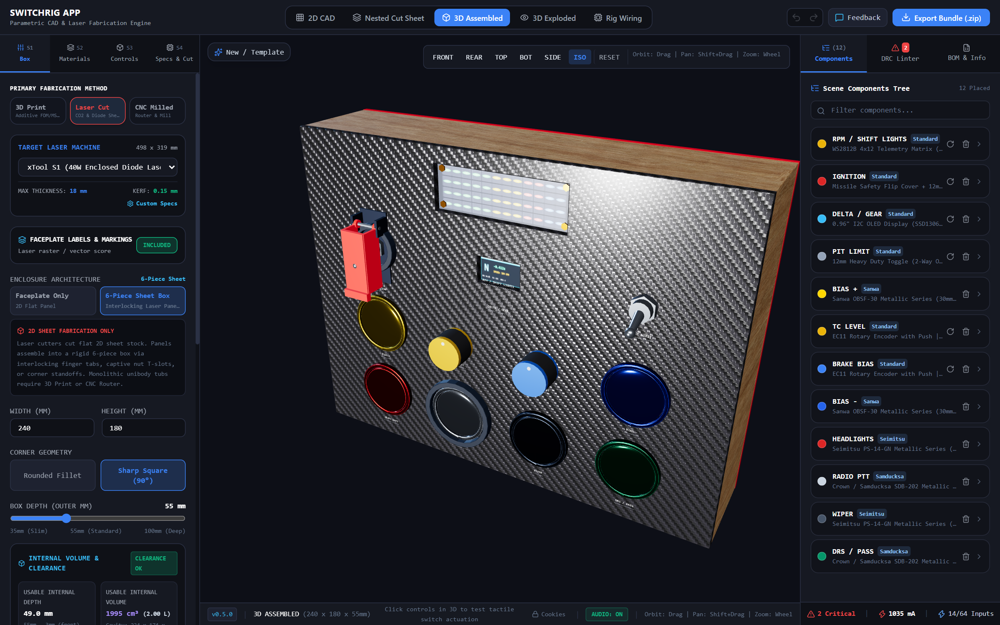
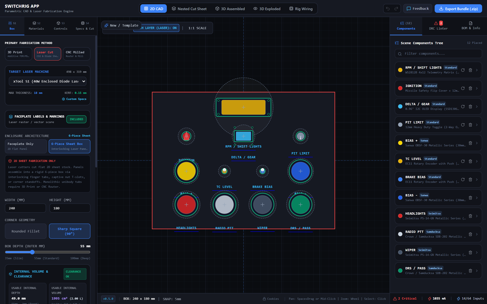
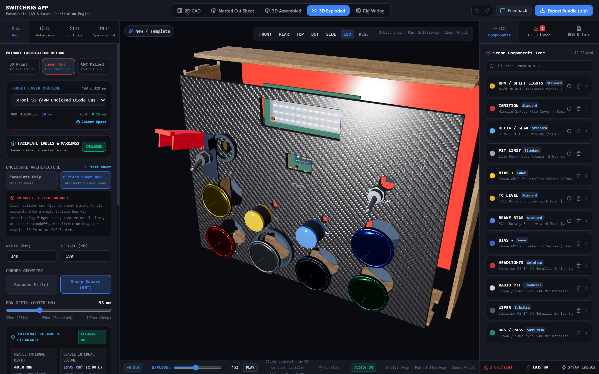

# SwitchRig Button Box Studio

SwitchRig Button Box Studio is an in-browser parametric CAD studio, component layout engine, and Design for Manufacturing (DFM) verification platform for custom sim racing button boxes, flight simulator flight decks, and macro controllers.

* **Live Web Application:** [switchrigapp.com](https://switchrigapp.com)
* **Official Community & Issue Tracker:** Public repository for bug reporting, component footprint requests, machine profiles, and release changelogs.

---

## Studio Showcase

### Interactive 3D Assembly Studio
Real-time WebGL rendering featuring physical material finishes (carbon fiber weave, gloss acrylics, Baltic birch, anodized aluminum), interactive tactile switch actuation, and live audio synthesis.

  

### Parametric 2D CAD Canvas
Interactive vector layout canvas supporting 1:1 scale placement, alignment tools, laser kerf offset previews, and real-time Design Rule Check (DRC) clearance alerts.

  

### Exploded Mechanical Verification
Radial and axial exploded views to inspect interlocking finger tabs, captive nut traps, wire paths, and internal component depth clearances.

  

---

## Key Capabilities

* **Parametric 2D & 3D Enclosure Topologies:**
  * Interlocking 6-piece sheet boxes with zero-overhang flush finger joints.
  * Parametric captive T-nut joint traps with automatic setback and edge-margin DFM checks.
  * Unibody solid tubs and front-bezel enclosures for subtractive CNC milling and 3D printing.
  * Direct mounting options: 8020 aluminum extrusion side ears, VESA 75/100 patterns, and rear wall stealth slots.

* **Manufacturing-Centric Process Engines:**
  * Laser Cutters: CO2 (xTool P2, Glowforge Pro) and Blue Diode (xTool S1, Falcon 2) with automated kerf offset compensation.
  * CNC Routers: Carbide 3D Shapeoko 4, Nomad 3, and OpenBuilds LEAD with dogbone / T-bone corner fillets.
  * 3D Printers: Bambu Lab X1C / P1S and Prusa MK4 with parametric wall thickness and counter-bore clearance.

* **Verified Sim Racing & Arcade Component Catalog:**
  * Sanwa Denshi (OBSF-30, OBSF-24, Metallic Series, OBSC translucent).
  * Seimitsu (PS-14-GN, PS-14-K, flat plunger screw-in buttons).
  * Crown / Samducksa (SDB-202 with Cherry MX Silver mechanical switches).
  * Industrias Lorenzo / Suzo Happ (American concave and European convex buttons).
  * Rotary Encoders & Switches (Alps EC11, stepped rotary selector switches).
  * Heavy-Duty Switches (12mm toggles, missile safety flip-canopies).
  * Digital Displays & Telemetry (0.96 inch I2C OLED screens, WS2812B 4x12 RGB shift light bars).

* **Real-Time Design Rule Check (DRC) Engine:**
  * Z-Axis Crimp Collision Detection: Verifies internal enclosure depth against switch terminal bodies and quick-disconnect crimp spades.
  * Knuckle & Swing Envelope Analysis: Detects physical finger pinch clearance between adjacent arcade pushbuttons and toggle guards.
  * Laser Bed Envelope Clamping: Flags faceplate and side wall geometry exceeding active machine beds.
  * USB 5V Electrical Power Budget: Computes real-time current draw across all active telemetry displays and provides automated power injection recommendations.

* **Direct Multi-Format CAD Export:**
  * 1:1 DXF (R12/R14 standard with kerf compensation, organized into laser-cut, etch, score, and dimension layers).
  * SVG (Optimized with standard stroke weights for LightBurn, xTool Creative Space, and Glowforge).
  * 3D STEP & STL (Export 3D printable unibodies, faceplates, and drill templates).
  * Bill of Materials (BOM): Comprehensive fasteners, wiring terminals, power consumption, and material area estimates.

* **Acoustic Sound Stage:**
  * Real-time procedural Web Audio simulation replicating authentic Cherry MX Red linear, Blue clicky, Brown tactile, and Topre capacitive switch press physics.

---

## Community, Issue Reports & Hardware Requests

This repository serves as the public community hub for SwitchRig Button Box Studio.

* **Report a Bug:** Found a collision detection bug, CAD export misalignment, or browser rendering issue? [Open a Bug Report](../../issues/new?template=bug_report.yml).
* **Propose a Studio Feature:** Have an idea for a new CAD layout tool, export capability, or DRC check? [Submit a Feature Proposal](../../issues/new?template=feature_request.yml).
* **Request a Component Footprint:** Need a specific arcade pushbutton, rotary switch, flight switch, or display added to the catalog? [Submit a Component Footprint Request](../../issues/new?template=component_request.yml).
* **Request a Machine or Material:** Looking for a specific laser cutter bed profile, CNC router envelope, or acrylic/wood material? [Submit a Machine or Material Request](../../issues/new?template=machine_material_request.yml).
* **Release Notes:** Review comprehensive version changelogs in [CHANGELOG.md](CHANGELOG.md).

---

## License

Documentation, issue templates, and assets are Copyright (c) 2026 upioneer. All Rights Reserved. See [LICENSE.md](LICENSE.md).
The SwitchRig core application is hosted and maintained at [switchrigapp.com](https://switchrigapp.com).
